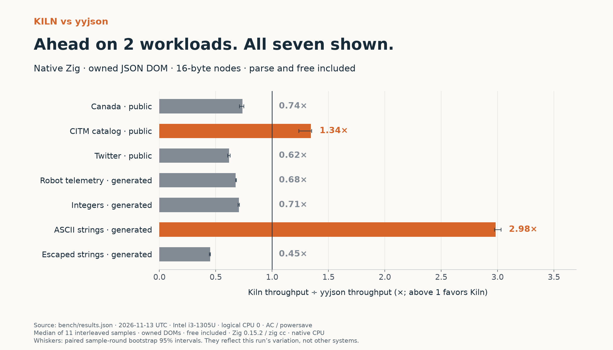
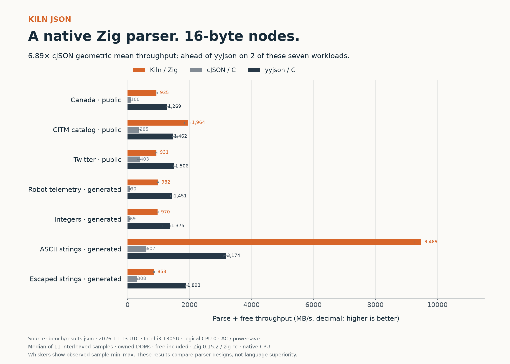
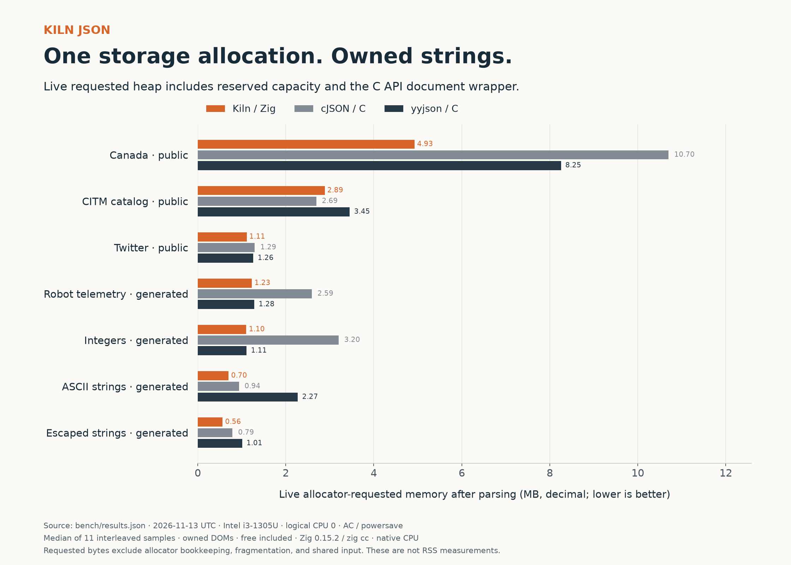

# Measured results

Measured 2026-11-13T19:16:39.450253+00:00 on an Intel Core i3-1305U laptop with about 8 GB RAM. All benchmark processes were pinned to logical CPU 0 (a performance-core hardware thread), using AC power and the existing powersave governor. Background desktop activity and laptop power management can affect results.

Each case has 11 randomized, interleaved samples, with warmup and a nominal 250 ms timed interval per sample. Throughput is decimal MB/s. The actual durations and all raw samples are in `bench/results.json`.

**Kiln achieved 2.31–15.59× cJSON parse + free throughput on these seven workloads (6.89× equally weighted geometric mean). It was ahead of yyjson on 2 workloads and behind on 5.**

- **Canada · public:** Kiln 935.4 MB/s; cJSON 99.7; yyjson 1269.4. Kiln/yyjson **0.74×** (bootstrap 95% interval 0.71–0.75×). Live requested heap is 40.3% lower than yyjson.
- **CITM catalog · public:** Kiln 1963.6 MB/s; cJSON 385.1; yyjson 1461.8. Kiln/yyjson **1.34×** (bootstrap 95% interval 1.24–1.35×). Live requested heap is 16.5% lower than yyjson.
- **Twitter · public:** Kiln 931.2 MB/s; cJSON 403.1; yyjson 1505.7. Kiln/yyjson **0.62×** (bootstrap 95% interval 0.61–0.63×). Live requested heap is 12.0% lower than yyjson.
- **Robot telemetry · generated:** Kiln 982.3 MB/s; cJSON 90.2; yyjson 1450.9. Kiln/yyjson **0.68×** (bootstrap 95% interval 0.68–0.68×). Live requested heap is 4.2% lower than yyjson.
- **Integers · generated:** Kiln 970.1 MB/s; cJSON 68.7; yyjson 1374.7. Kiln/yyjson **0.71×** (bootstrap 95% interval 0.70–0.71×). Live requested heap is 0.7% lower than yyjson.
- **ASCII strings · generated:** Kiln 9469.4 MB/s; cJSON 607.3; yyjson 3174.3. Kiln/yyjson **2.98×** (bootstrap 95% interval 2.97–3.03×). Live requested heap is 69.2% lower than yyjson.
- **Escaped strings · generated:** Kiln 852.7 MB/s; cJSON 308.1; yyjson 1892.5. Kiln/yyjson **0.45×** (bootstrap 95% interval 0.44–0.45×). Live requested heap is 44.2% lower than yyjson.

## Memory and allocation trade-off

Kiln now allocates one storage block for nodes and source-sized string capacity. The C API also allocates its small document wrapper: two allocations per parse in total. Capacity is retained until freeing the document; it is not shrunk after parsing. This trades some retained memory for less allocation work and fewer system calls.

Live memory is total requested allocation size after parsing, including the wrapper and unused capacity. The original input is shared and excluded. Peak figures and allocation-call counts are recorded too. Instrumentation runs separately from timing; figures exclude allocator bookkeeping and fragmentation and are not RSS measurements.

- `canada` live requested MB: Kiln 4.926; cJSON 10.700; yyjson 8.254. Kiln allocation calls: 2.
- `citm_catalog` live requested MB: Kiln 2.885; cJSON 2.692; yyjson 3.455. Kiln allocation calls: 2.
- `twitter` live requested MB: Kiln 1.112; cJSON 1.295; yyjson 1.263. Kiln allocation calls: 2.
- `telemetry` live requested MB: Kiln 1.230; cJSON 2.593; yyjson 1.285. Kiln allocation calls: 2.
- `integers` live requested MB: Kiln 1.103; cJSON 3.200; yyjson 1.110. Kiln allocation calls: 2.
- `strings` live requested MB: Kiln 0.700; cJSON 0.935; yyjson 2.273. Kiln allocation calls: 2.
- `escaped` live requested MB: Kiln 0.563; cJSON 0.789; yyjson 1.008. Kiln allocation calls: 2.

## Compared with original Kiln under the same conditions

The original parser was recompiled with the same compiler and interleaved in this run as `kiln_v1`. Its source is preserved in `bench/baseline/src/`. These comparisons use the fresh measurements, not the older battery-powered run.

- `canada`: 2.23× original Kiln throughput (bootstrap 95% interval 2.12–2.25×); live requested bytes 2,675,146 → 4,926,123.
- `citm_catalog`: 1.77× original Kiln throughput (bootstrap 95% interval 1.74–1.79×); live requested bytes 1,239,795 → 2,885,044.
- `twitter`: 1.34× original Kiln throughput (bootstrap 95% interval 1.33–1.36×); live requested bytes 804,125 → 1,111,994.
- `telemetry`: 2.72× original Kiln throughput (bootstrap 95% interval 2.60–2.75×); live requested bytes 1,032,580 → 1,230,492.
- `integers`: 2.50× original Kiln throughput (bootstrap 95% interval 2.45–2.52×); live requested bytes 800,080 → 1,102,881.
- `strings`: 3.34× original Kiln throughput (bootstrap 95% interval 3.30–3.39×); live requested bytes 685,080 → 700,097.
- `escaped`: 2.27× original Kiln throughput (bootstrap 95% interval 2.21–2.29×); live requested bytes 399,080 → 562,987.

## Parse plus traversal

This mode visits every node and decoded string byte, folds f64 values into a checksum, and frees the document. Checksums match for every library on every dataset. Kiln uses a contiguous preorder traversal; cJSON and yyjson use recursive iteration. The mode measures those traversal implementations as well as parsing.

- `canada`: Kiln 821.2 MB/s; cJSON 95.4; yyjson 935.6; Kiln/yyjson 0.88×.
- `citm_catalog`: Kiln 1412.8 MB/s; cJSON 354.5; yyjson 1145.7; Kiln/yyjson 1.23×.
- `twitter`: Kiln 570.6 MB/s; cJSON 309.9; yyjson 725.2; Kiln/yyjson 0.79×.
- `telemetry`: Kiln 576.2 MB/s; cJSON 83.5; yyjson 716.9; Kiln/yyjson 0.80×.
- `integers`: Kiln 713.9 MB/s; cJSON 64.3; yyjson 879.1; Kiln/yyjson 0.81×.
- `strings`: Kiln 856.2 MB/s; cJSON 370.2; yyjson 727.7; Kiln/yyjson 1.18×.
- `escaped`: Kiln 534.9 MB/s; cJSON 255.1; yyjson 814.1; Kiln/yyjson 0.66×.

## Reproduction and boundaries

- Observed timing coefficient of variation across all cases: 0.7–9.9%. Min/max samples are retained; the absolute-throughput chart shows their range.
- Ratio intervals use 5,000 deterministic paired sample-round bootstrap resamples. They describe sampling variation within this run, not systematic bias or performance on other systems. Details and derived values are in `bench/comparisons.json`.
- Zig: ReleaseFast, native CPU target. C: zig cc, `-O3 -march=native`, no LTO. Exact compiler output, source fingerprints, and dependency revisions are in the raw metadata.
- All implementations use fresh owning-document APIs and own their decoded strings. Kiln includes strict UTF-8 and grammar validation; cJSON does not offer equivalent strict UTF-8 validation.
- Timed work includes allocation, parsing, and destruction. It excludes file reads and process startup. No reusable arena, pooled cJSON allocator, or in-situ yyjson mode is used.
- Kiln reuses the MIT-licensed Eisel–Lemire converter from Zig 0.15.2, supplying the mantissa and exponent already scanned. Ambiguous cases and numbers exceeding 19 digits retain the standard float-parser fallback. Attribution is in `src/float/ORIGIN.md`.
- This compares algorithms, allocation patterns, and data layouts. It does not establish that Zig is intrinsically faster than C. cJSON and yyjson provide capabilities absent from this read-only parser.
- Generated workloads are labeled. Public source URLs and hashes are in `bench/datasets.json`.
- Kiln stores numbers as f64. Other implementations may preserve integer types; checksums convert all numbers to f64.

Run the commands in README.md to reproduce. Results depend on CPU, compiler, power state, and workload.
