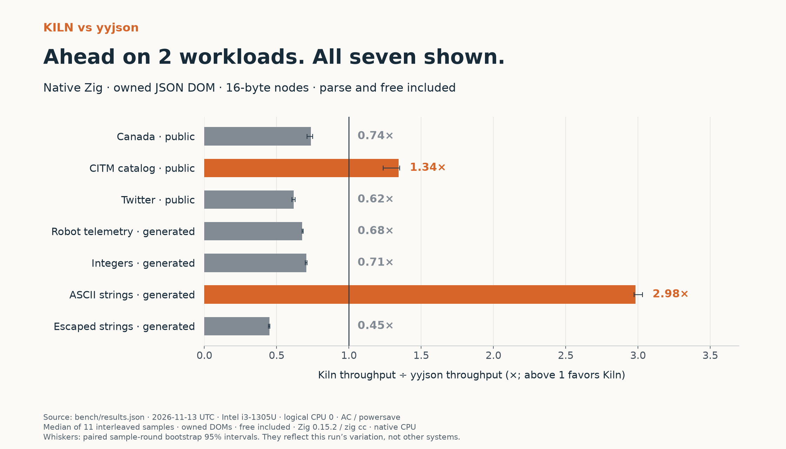
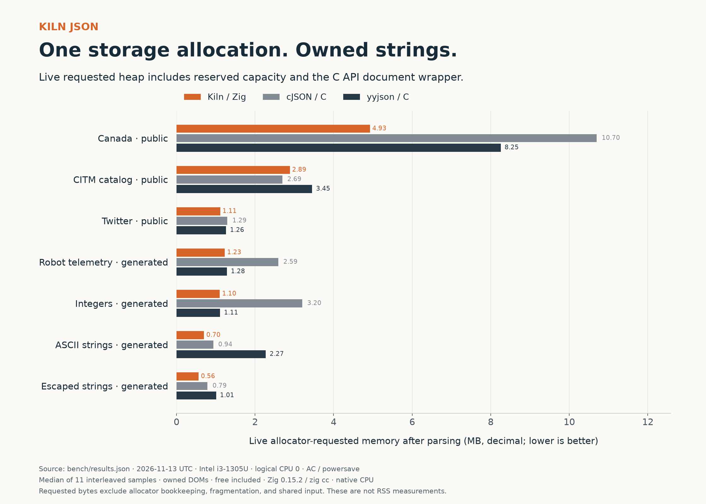

# kiln-zig

[](https://github.com/5usu/kiln-zig/actions/workflows/ci.yml)

**A small JSON parser. A surprisingly useful way to learn Zig.**

Kiln turns JSON into an owned, read-only document using **16-byte nodes** and **one storage allocation**. It started as a learn-Zig project, then became an experiment in how much memory layout, SIMD, and fewer allocations can change performance.

## What happened on an i3 laptop

Against yyjson, the measured parse + free results were:

- **1.34× throughput on public CITM**, with **16.5% less requested heap**.
- **2.98× throughput on generated ASCII strings**.
- yyjson was faster on the other five workloads. All seven are shown below.



These are workload-specific results from an Intel i3-1305U laptop, using owned strings and 11 interleaved rounds on one CPU thread. The original Kiln implementation was recompiled and measured in the same run. There are **616 raw samples**, not just a screenshot of the best case.

[Full results and methodology](BENCHMARKS.md) · [Raw samples](bench/results.json) · [Ratios and intervals](bench/comparisons.json) · [How it works](docs/DESIGN.md)

## Run it

On Linux x86-64, you need Git and Python 3.9+. The helper installs a checksum-verified **Zig 0.15.2** locally if needed. It does not change your system compiler.

```sh
git clone https://github.com/5usu/kiln-zig.git
cd kiln-zig
./scripts/build.sh
./zig-out/bin/kiln examples/robot.json robot
```

The example prints a parse summary and `arm`. Try your own file:

```sh
./zig-out/bin/kiln your-file.json
./zig-out/bin/kiln your-file.json root_object_key
```

An existing compiler can be selected with `ZIG=/absolute/path/to/zig`. This project targets **0.15.2**; newer Zig releases may require changes. The CLI, C API, and scripts are verified on Linux x86-64.

## Reproduce everything

For the full pipeline, use **Python 3.12+** (needed by the pinned plotting dependencies):

```sh
./scripts/reproduce.sh
```

That command builds the project, runs the tests, generates/downloads the pinned datasets, compiles the original Kiln baseline, benchmarks all four implementations, and regenerates the reports and PNG/SVG charts. Plotting dependencies go into a local virtual environment.

Optional controls:

```sh
BENCH_CPU=0 BENCH_SAMPLES=11 BENCH_DURATION_MS=250 CASES=100000 ./scripts/reproduce.sh
```

The default CPU is the first one allowed by your process affinity. Results will depend on hardware, compiler, power state, and background work. The pipeline replaces the local benchmark/report files with your measurements.

Prefer individual steps? See [REPRODUCING.md](docs/REPRODUCING.md).

## What made it faster

1. **Reserve once.** A quick SIMD punctuation count gives a conservative node bound. Nodes and string capacity then share one block, with no buffer growth or final shrinking.
2. **Scan and copy together.** Ordinary text is checked and copied 32 bytes at a time. Short ASCII strings stay on a small hot path; escapes and Unicode have a separate path.
3. **Read digits once.** Validation and number accumulation share a pass. The already-read digits feed exact conversion paths, including a credited converter from Zig's standard library.

The faster layout retains more unused storage than the original compacting implementation. The memory numbers include that capacity. The C API also allocates a small document wrapper, making **two allocations per measured parse**.



## Correctness comes before the chart

```sh
./scripts/test.sh
# Match the larger checked-in local validation run:
CASES=100000 ./scripts/test.sh
```

The checked-in validation includes:

- Ten unit-test groups in Debug, ReleaseFast, and ReleaseSafe: ownership, lookup/traversal, malformed input, allocation failures, numeric rounding, SIMD boundaries, reservation bounds, and Unicode.
- All **95 required-valid** and **188 required-invalid** JSONTestSuite cases. Implementation-defined cases are reported separately.
- **600,000 generated, mutated, and arbitrary-byte checks** across ReleaseFast and ReleaseSafe, plus document comparisons on all seven workloads.

The Python reference decoder is configured to match Kiln's finite-f64 policy. Arbitrary-byte tests check robustness, rather than semantic equivalence. These bounded checks are not a production security audit.

[Validation record](tests/VALIDATION.md) · [ReleaseFast report](tests/correctness.json) · [ReleaseSafe report](tests/correctness-safe.json) · [GitHub Actions](https://github.com/5usu/kiln-zig/actions)

## Use it from Zig

Import `src/root.zig` as a module named `kiln`, as shown in `build.zig`:

```zig
const std = @import("std");
const kiln = @import("kiln");

// Link libc when using this allocator.
var diagnostic = kiln.Diagnostic{};
var doc = try kiln.Document.parse(
    std.heap.raw_c_allocator,
    "{\"robot\":\"arm\",\"rate_hz\":30}",
    .{},
    &diagnostic,
);
defer doc.deinit();

const index = doc.get(0, "robot").?;
std.debug.print("{s}\n", .{doc.string(doc.nodes.items[index])});
```

The document owns its strings; the input can be freed after parsing. Treat `nodes` and `strings` as read-only views and free only the document. Do not copy a document and deinitialize both copies.

The C API builds as `zig-out/lib/libkiln.so`; its header is [kiln.h](src/kiln.h).

## Scope and credits

Kiln is an independent implementation, not a cJSON port or drop-in replacement. It provides a read-only DOM; there is no serializer, mutation API, JSON Pointer, or streaming mode. Numbers are finite `f64`: large integers may round, overflow is rejected, and underflow may become zero. UTF-8 and surrogate pairs are validated. The default nesting limit is 256; duplicate keys and input order are preserved, and `get()` returns the first match.

Conservative reservation can overestimate storage when punctuation occurs inside strings. Requested heap is not RSS. The input limit is u32 bytes, and allocation-size arithmetic is checked.

The parser and layout are written in Zig. Exact Eisel–Lemire conversion code is copied from **Zig 0.15.2** with its MIT license and [attribution](src/float/ORIGIN.md). cJSON, yyjson, and JSONTestSuite are vendored for comparison/testing, with their original licenses and [pinned revisions](vendor/versions.json). Public benchmark inputs are fetched from [pinned URLs with SHA-256 checks](bench/datasets.json).

MIT licensed. Built to learn, measure, and make the next optimization explainable.
